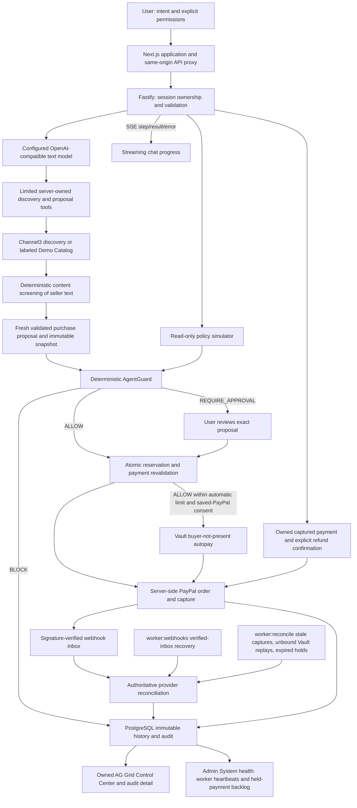

# Application architecture

The AI never receives credentials or unrestricted money movement. AgentGuard decisions, user approvals and PayPal outcomes are independent records. Payment and refund calls leave the database transaction only after an operation is claimed; retries use the stored operation identifiers. Unknown outcomes remain held.

- **Content screening.** Seller text (title, brand, category, merchant, description) is screened deterministically before it reaches the model, and again by AgentGuard from the stored product snapshot (which keeps a bounded description). Instruction-like listings are excluded from chat results (`excludedProducts`) and blocked with `PRODUCT_CONTENT_*` reason codes.
- **Streaming chat.** `POST /api/agent/chat/stream` runs the same bounded chat as `POST /api/agent/chat` and streams server-templated `step` events, then one `result` or `error`.
- **Policy simulator.** `POST /api/mandates/:id/simulate` runs the real AgentGuard engine against a hypothetical purchase in a read-only transaction; it never creates a proposal, reservation or audit row.
- **Decision explanations.** Every stored decision is explained deterministically (`decision.explanation`); the explanation never changes the verdict.
- **Vault autopay.** With explicit, versioned saved-PayPal consent, an AgentGuard ALLOW proposal within the automatic limit can be paid buyer-not-present. The PayPal token ID is encrypted at rest (`TOKEN_ENCRYPTION_KEY`) and never leaves the server. Every other case, and any payer-action response from PayPal, keeps the standard buyer-approval checkout.
- **Workers.** `worker:webhooks` replays verified inbox events with leases and backoff. `worker:reconcile` reconciles stale captures from provider reads, replays the same idempotent create-order request for Vault payments whose outcome was unknown (only while the saved method, switches and mandate still allow it), holds and surfaces to admins those it cannot safely replay, and releases expired holds of unpaid proposals. Neither worker creates a new financial operation.

Signed AP2-style mandates: see [AP2 mandates](./AP2_MANDATES.md). Agent access over MCP: see [MCP integration](../integrations/MCP.md).

The frontend uses the same warm design system across landing, auth, mandates, chat, approvals, checkout, orders, settings and analytics. Dashboard totals use owned, confirmed financial data; loaded-row charts disclose their pagination scope. Order links use payment IDs; proposals without a payment have their own policy/audit detail route.

Deployment is optional and currently deferred. The Render template schedules both workers as cron jobs. Render Workflows, AG Studio's Agent Framework, voice and recurring purchases are separate unimplemented integrations, not substitutes for the working local MVP.
